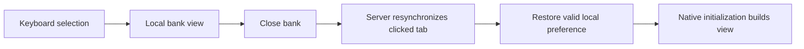
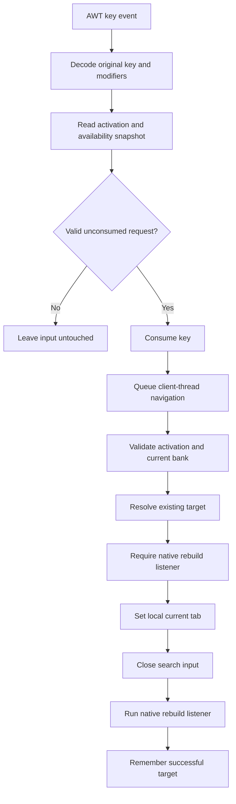
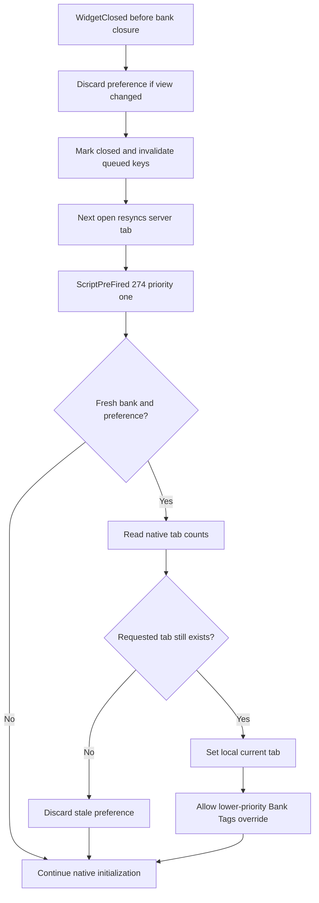

# Bank tab reopening regression

_Issue 1 follow-up, investigated 2026-10-16; fix version 1.1.1._

## Summary

Reporter reproduction: click tab 3, use Ctrl+5 (or cycling) to display tab 5, close and reopen
the bank. Expected: tab 5. Version 1.1.0: tab 3, even after withdrawing from tab 5.[^1]

The shortcut updated the local `BANK_CURRENTTAB` and rebuilt the view, but did not remember its
choice across the next bank initialization. RuneLite documents that bank open resynchronizes
the server's last clicked native tab. Its Bank Tags plugin already overrides that local varbit
before initialization when restoring a tag.[^2] Native switch script 504 sets the same varbit
and rebuilds; it has no separate remembered-tab variable to update.[^3]

## Fix and limits

Keep the last successful keyboard target in memory. Before a fresh bank initialization, restore
that local varbit if the tab still exists. Native initialization consumes it without overwriting
it, through `bankmain_viewbuttons` and `bankmain_build`.[^4] This does not invoke a menu operation,
send a game action, or change server state. It follows RuneLite's existing local-view restoration
pattern, with final acceptance still subject to Plugin Hub review.[^2][^5]

Native script 504 clears the preference when a later click selects a tab, separator heading,
All, or potion storage. Client-tick and close-time reconciliation also respect selections made
by other plugins. `WidgetClosed` is documented as occurring before closure.[^6] Restore priority
1 runs before Bank Tags' default priority, leaving its remembered tag authoritative.

The preference is intentionally login-local: logout, login, world hop, connection loss, restart,
or disable clears it. No account identifiers or persistent account state are read or written.
Deleted tabs are discarded; they cannot reappear when a later tab occupies the same number.
An already-open bank reinitialization does not restore an older choice. Closing the bank also
invalidates queued shortcuts so an old key cannot select a tab in a newly opened bank.

## Evidence and assumptions

| Candidate | Probe and result | Status |
|---|---|---|
| Number-key remapping or threading | Reporter confirms both inputs and remapping work; existing AWT/client-thread tests pass | Checked out for this symptom |
| Local display not changing | Reporter sees tab 5; packaged test also sees 5 before close | Checked out |
| Server restores old clicked tab | Official Bank Tags source; test resets to 3 before init | Confirmed mechanism |
| Missing client varc | Native script 504 only changes current-tab state and rebuilds | Checked out |
| Restore overwritten by native init | Script 274 path inspected; no current-tab assignment | Checked in source |
| Later mouse/other-view selection overridden | Script-504 and change-before-close regressions | Covered by tests |
| Old account or disabled-plugin choice leaks | Login/hop/disconnect/disable resets | Covered by tests |
| Installed game behaves identically | No logged-in game interaction performed for this patch | Still needs user validation |

Baseline regression `keyboardTabSurvivesServerResyncOnRepeatedBankReopens` failed on the old
implementation: `expected:<5> but was:<3>`. The same test passes after the repair and repeats
the close/server-resync/open sequence three times. Tests use the real RuneLite EventBus and
KeyManager, AWT dispatch, and client/widget proxies that reject off-client-thread access.
The packaged test task asserts production classes were loaded from the built JAR.

Coverage includes top-row/numpad mappings, remapping, All, both cycle directions, sparse/missing
tabs, repeated reopening, native-click precedence, failed selection, cached hidden widgets,
open-bank reinitialization, other-view changes immediately before close, Bank Tags subscriber
priority, queued input cancellation, logout/hop/disconnect and disable/re-enable. There is no
historical stored data to migrate; existing installations receive the code through Plugin Hub.
No rendering, label position, or display-setting code changes in this repair.

Run `scripts/verify.ps1` for source and packaged tests, capability scans with mutation controls,
strict dependency verification, no-runtime-dependencies check, and reproducible-JAR checks.
These prove the plugin contract and packaged implementation, not a live server test.

## Flow overview

### Selection detail

### Reopening detail

## Complete reproduction trace

This trace expands the successful reported reproduction through all plugin boundaries. Native
server internals are not available: the server node is supported by RuneLite's documented
resynchronization behavior and the reporter, not a packet capture. The native build internals
are outside this plugin; their relevant selection read is inspected in RuneLite's script dump.

```mermaid
flowchart TB
    accTitle: Full tab reopening failure trace
    accDescr: Detailed reproduction path with the missing restoration in version 1.1.0 and the new local override in 1.1.1.
    subgraph initial_state [Initial state]
        click_three[User clicks native tab three] --> native_switch[Native script 504 selects three]
        native_switch --> server_three[Server remembers clicked three]
        server_three --> client_tick[ClientTick reads bank widget]
        client_tick --> visibility[Check item-area visibility]
        visibility --> read_counts[Read nine tab counts]
        read_counts --> publish[Publish immutable availability mask]
    end
    subgraph keyboard [Keyboard selection]
        ctrl_five[User presses Ctrl five] --> awt[AWT KeyManager dispatch]
        awt --> modifiers[Check Ctrl and excluded modifiers]
        modifiers --> original[Read original extended key code]
        original --> numeric[Decode numbered target five]
        numeric --> activation[Read activation token]
        activation --> mask[Read availability mask]
        mask --> eligibility[Reject consumed or unavailable requests]
        eligibility --> consume[Consume matching event]
        consume --> enqueue[Queue client-thread Runnable]
        enqueue --> token[Compare captured activation token]
        token --> available[Check current activation and availability]
        available --> widget[Get bank items widget]
        widget --> hidden[Reject null or hidden widget]
        hidden --> current[Read current-tab varbit]
        current --> counts[Read current tab counts]
        counts --> target[Resolve target five]
        target --> listener[Get native inventory-transmit listener]
        listener --> require_listener[Reject missing listener]
        require_listener --> set_five[Set local current-tab varbit five]
        set_five --> close_search[Run message-layer-close script]
        close_search --> rebuild[Run native bank rebuild listener]
        rebuild --> display_five[Native build displays tab five]
        display_five --> cache[New: remember target five]
    end
    subgraph reopening [Close and reopen]
        user_close[User closes bank] --> closing[WidgetClosed fires on client thread]
        closing --> outgoing[Read outgoing current tab]
        outgoing --> reconcile[Keep matching preference]
        reconcile --> clear_mask[Clear availability mask]
        clear_mask --> closed[Mark bank closed]
        closed --> invalidate[Replace activation token]
        invalidate --> user_open[User reopens bank]
        user_open --> resync[Server restores current tab three]
        resync --> pre_init[ScriptPreFired for native init 274]
        pre_init --> active[Check plugin active]
        active --> fresh[Check fresh bank opening]
        fresh --> open_state[Mark bank open]
        open_state --> remembered[Check remembered target exists]
        remembered --> validate_counts[Read native tab counts]
        validate_counts --> valid[Validate target five still populated]
        valid --> restore[New: restore local current tab five]
        restore --> tag_override[Default-priority Bank Tags may override]
        tag_override --> init[Native init 274 resumes]
        init --> viewbuttons[Native view-buttons procedure 3276]
        viewbuttons --> native_build[Native bank build 277 reads current tab]
        native_build --> shown[Tab five displayed]
        resync -.-> old_path[Old: no restore subscriber]
        old_path -.-> wrong[Native build displays tab three]
    end
    publish --> ctrl_five
    cache --> user_close
    classDef failure fill:#fee2e2,stroke:#dc2626,color:#7f1d1d
    classDef fixed fill:#dcfce7,stroke:#16a34a,color:#14532d
    class old_path,wrong failure
    class cache,restore,shown fixed
```

Selection rejection branches preserve existing behavior: no target mutation without a valid
bank/target/listener. Unexpected navigation errors clear remembered state and log
`BTS_NAVIGATION_FAILED`; restore and close-capture errors clear it and log
`BTS_TAB_RESTORE_FAILED` or `BTS_TAB_CAPTURE_FAILED`. Missing tabs are normal lifecycle events,
not errors. Game-state reset and disable paths clear both the preference and input availability.

## References

[^1]: Reporter follow-up, 2026-10-16. https://github.com/iamthecodeDECODEDORG/runelite-bank-tab-shortcuts/issues/1#issuecomment-6208286172
[^2]: RuneLite 1.13.1 Bank Tags `TabInterface`, pre-init hook and `init()` server-resync comment. https://github.com/runelite/runelite/blob/runelite-parent-1.13.1/runelite-client/src/main/java/net/runelite/client/plugins/banktags/tabs/TabInterface.java
[^3]: RuneLite native script dump, commit 736e78d4c4260ba2a9d8ce3d2d665a98185de42e, script 504. https://github.com/runelite/cs2-scripts/blob/736e78d4c4260ba2a9d8ce3d2d665a98185de42e/scripts/%5Bclientscript%2Cbankmain_switchtab%5D.cs2
[^4]: Same native script dump, bank initialization. https://github.com/runelite/cs2-scripts/blob/736e78d4c4260ba2a9d8ce3d2d665a98185de42e/scripts/%5Bclientscript%2Cbankmain_init%5D.cs2
[^5]: Plugin Hub submission/review policy, checked 2026-10-16. https://github.com/runelite/plugin-hub/blob/master/README.md#reviewing
[^6]: RuneLite `WidgetClosed` event contract. https://github.com/runelite/runelite/blob/runelite-parent-1.13.1/runelite-api/src/main/java/net/runelite/api/events/WidgetClosed.java
